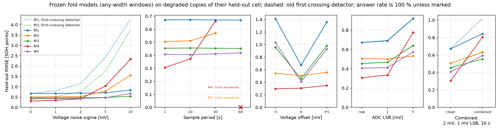

# Partial-charge SOH estimation

[](https://github.com/aqjole/charge-window-soh/actions/workflows/ci.yml)

**Question.** A BMS sees part of a constant-current charge as voltage against time.
How much does incremental-capacity (IC) analysis add to battery state-of-health (SOH)
estimation over a simple charge-counting (ΔQ) estimator, and does that gain survive
noisy, sparse voltage logs like a real BMS produces?

**Short answer.** On clean lab logs, IC helps: the IC peak cuts the linear model's
error by a quarter, and the best model reaches 0.31 SOH points. On BMS-like logs the
gain is fragile. From 5 mV of voltage noise, the IC models do worse than plain ΔQ;
the GPR IC model also loses its edge at 30 s logging, and at 60 s neither IC model
gives an estimate at all. The most robust model is ΔQ with Gaussian-process
regression: 0.45-0.64 SOH points across noise, ADC quantization and sparse logging.
Its weak spot is a constant voltage-sensor offset: ±5 mV doubles its error.

Data: Oxford Battery Degradation Dataset 1, 8 cells, 519 charge curves. Every
accuracy number below is from nested leave-one-cell-out validation. A streaming C
version of the simplest estimator matches the Python reference to 1e-14.

## Main results

Error unit: **SOH points**, i.e. 100 · (estimated − measured capacity) / beginning-of-life
capacity. Each model picks its own voltage window inside every validation fold.

### Clean logs

| Model | Inputs | RMSE | Worst cell | Max error | Window (median) | 95 % interval covers |
|---|---|---:|---:|---:|---:|---:|
| M0 | none (training mean) | 6.77 | 7.92 | 24.4 | | |
| M1 | ΔQ, linear | 0.67 | 1.15 | 7.5 | 25 min | |
| M2 | ΔQ + IC peak, linear | 0.51 | 1.10 | 7.1 | 34 min | |
| M3 | ΔQ, GPR | 0.45 | 0.65 | 3.6 | 26 min | 91 % |
| M4 | ΔQ + IC peak, GPR | **0.31** | **0.44** | **2.1** | 34 min | 95 % |
| M5 | ΔQ of each window half, GPR | 0.41 | 0.84 | 5.0 | 32 min | 97 % |

RMSE is pooled over all held-out traces. Worst cell is the highest single-cell RMSE.
Window is the median time the selected window takes at 1C. Coverage uses calibrated
GPR intervals. The decision rule, fixed in advance, counts an addition as a gain only
if it beats its control on at least 7 of 8 held-out cells:

- **IC peak, linear (M2 vs M1):** helps, better on 8 of 8 cells.
- **IC peak, GPR (M4 vs M3):** better on 6 of 8, so no detectable gain when each
  model picks its window freely. At an equal 200 or 300 mV width it passes (7 and 8 of 8).
- **Two segments (M5 vs M3):** better on 6 of 8, so no detectable gain.

### BMS-like logs

Each fold's frozen model is applied to degraded copies of its held-out cell, with
20 random seeds where noise or sampling phase is random. Every model answers 100 % of
traces unless marked.

| Log condition | M1 | M2 | M3 | M4 | M5 |
|---|---:|---:|---:|---:|---:|
| Clean | 0.67 | 0.51 | 0.45 | **0.31** | 0.41 |
| Noise σ = 2 mV | 0.69 | 0.53 | 0.46 | **0.42** | 0.43 |
| Noise σ = 10 mV | 0.84 | 1.56 | **0.54** | 2.33 | 0.67 |
| Offset ±5 mV | 1.36-1.41 | 0.54-0.56 | 0.96-0.98 | **0.30-0.35** | 0.93-1.03 |
| ADC step 5 mV | 0.92 | **0.53** | 0.64 | 0.78 | 0.57 |
| One sample per 30 s | 0.67 | 0.57 | 0.45 | 0.66 | **0.41** |
| One sample per 60 s | 0.67 | no answer | 0.45 | no answer | **0.42** |
| Combined: 2 mV noise, 1 mV ADC step, 10 s | 0.84 | 0.63 | **0.55** | 0.81 | 0.59 |



What the table shows:

- **The IC peak is the noise-sensitive part.** It comes from a numerical derivative,
  so noise and coarse sampling hit the IC models first. At 60 s logging the window
  has too few samples for an IC curve at all.
- **ΔQ is a time measurement and barely notices noise or sparse logging** once the
  window detector averages repeated level crossings (see Method). With the
  first-crossing rule used earlier, M1 reached 4.26 at 10 mV noise; now it is 0.84.
- **A constant voltage offset is the one thing ΔQ cannot absorb.** It moves the
  window levels themselves. The IC models are nearly immune; the measured peak
  voltage moves with the offset, which likely lets them correct for it.
- **Calibrated intervals hold on clean data but not off it.** Calibrated M3 and M5
  intervals cover only 53-66 % under a ±5 mV offset; M4 covers 49 % at 5 mV noise.

Per-cell tables, the window-width trade-off, interval calibration and every
degraded case are in [`results/`](results/README.md).

## Method


**Data.** [Oxford Battery Degradation Dataset 1](https://doi.org/10.5287/bodleian:KO2kdmYGg):
8 Kokam 740 mAh pouch cells cycled at 40 °C, with a 1C characterization every 100
cycles, giving 519 charge curves. The estimator sees only voltage and time of the
1C constant-current charge (current is taken as the nominal 740 mA). The label is the
capacity of the paired 1C discharge. SOH is that capacity over the cell's first
capacity, which a BMS would store at beginning of life. The loader checks the file
hash and five audit gates first ([`results/audit.md`](results/audit.md)).

**Window and features.** A window [V1, V2] is a voltage band on the charge curve.
The grid has V1 from 3.5 to 3.9 V and widths of 100-400 mV, with V2 at most 4.15 V,
giving 17 windows.

- *Window detector:* time-below-level. Between arming (below V1 − 10 mV) and done
  (above V2 + 30 mV), it accumulates how long the voltage spends below V1 and below
  V2. On a clean trace this equals the interpolated crossing times. With noise,
  repeated crossings average out instead of the first one winning. It needs two
  running sums and no buffer.
- *ΔQ* = 740 mA × (time between the two levels).
- *IC peak:* height and voltage of the dQ/dV maximum inside the window (5 mV bins,
  Savitzky-Golay 7 points, order 2). These settings were frozen before the first
  run that used them.
- *Two segments:* ΔQ of each half of the window, split at the midpoint voltage.
- *No estimate:* a trace that never arms, never completes, has a gap over 120 s
  or gives no usable IC peak counts as unanswered, by reason. It is never dropped.

**Models.** M0-M5 as in the table. GPR uses a Matérn 5/2 kernel with one length
scale per input plus a white-noise term, on standardized inputs, with fixed seeds.

**Validation.** Nested leave-one-cell-out:

- *Outer loop:* each cell is held out once.
- *Inner loop:* inside each fold, every model picks its window by a second
  leave-one-cell-out on the 7 training cells. The score is mean per-cell RMSE, a
  window must answer at least 95 % of traces, and ties go to the narrower window.
  The held-out cell is never used for any choice.
- *Comparisons:* paired on the traces both models answered, with the 7-of-8-cells
  rule above (one-sided sign test, p = 0.035).
- *GPR intervals:* calibrated per fold from the inner held-out errors, so the
  calibration also uses training cells only.

**BMS-like logs.** Each fold's frozen model sees degraded copies of its held-out
cell. Degradation is applied in logger order: decimate (sample-and-hold, random
phase), add offset and Gaussian noise, round to the ADC step. Then detection and
features run as usual.

## C estimator

`c/soh_est.c` is a streaming M1 in C99, double precision, with no heap and no
sample buffer:

```c
soh_est e;
soh_est_init(&e, &cfg);                /* window, coefficients, C0 */
for (...) soh_est_feed(&e, t_s, v_mV); /* SOH_RUNNING until the window completes */
if (soh_est_finish(&e) == SOH_OK) use(e.soh);
else report(e.status);                 /* NOT_ARMED, NO_V2 or GAP */
```

The shipped model is frozen by the same window rule over all 8 cells. It picks
3.8-4.0 V and fits capacity = 91.93 + 1.987 · ΔQ [mAh] on all cells; the generated
coefficients are in [`c/soh_model.h`](c/soh_model.h). Its expected accuracy is the
nested M1 result above, not a score on the cells it was fit to. The top three windows
were nearly tied (0.575 vs 0.578), see [`results/frozen.md`](results/frozen.md).

`build/replay` streams exported traces through the C code. On all 519 clean traces
and on seed 0 of the combined degraded case, it returns the same reason code as Python for
every trace and SOH within 1e-14 (gate 1e-4,
[`results/c_agreement.md`](results/c_agreement.md)). Unit tests also check it
against Python on synthetic traces that exercise every reason code.

## Limitations

- **One cell type, one temperature, one charge protocol.** 8 cells at 40 °C, a clean
  1C constant-current charge from empty. No claim beyond that.
- **Exploratory use of the 8 cells.** The detector change, M5 and interval
  calibration were added after earlier results on the same 8 cells. The
  nested validation keeps each number honest, but the choice of which models to
  report was not blind. A new dataset would be needed for a generalization claim.
- **Two cells drop abruptly near end of life** (cells 2 and 5, see
  [`results/capacity_fade.png`](results/capacity_fade.png)). They cause the largest
  errors of every model.
- **Sensor errors not covered.** Current is assumed constant and known; a current-gain
  error passes one-to-one into ΔQ and is not tested. Voltage offset is tested and is
  the main weakness of the ΔQ models.
- **Beginning-of-life capacity must be stored** per cell to turn capacity into SOH.
- **Bench and offline only.** The C code is double precision and has not been
  ported to a microcontroller.

## Related work

Richardson, Birkl, Osborne and Howey, *Battery capacity estimation from
partial-charging data using Gaussian process regression*, ASME Dynamic Systems and
Control Conference 2017 (DSCC2017-5365), use the same 519 curves. They regress
capacity with a GP on the times to reach four equally spaced voltages inside a
measured segment, with leave-one-cell-out validation. They report capacity RMSE in
percent: 2.10 % with 10 s of data and 1.10 % with 450 s (both starting at 3.5 V),
and 0.49 % with 1,450 s starting at 3.7 V.

These are not directly comparable with the numbers here. Their label is capacity
from integrating the charge curve. The quoted figures are single entries of a grid
of results over start voltage and duration, not windows chosen inside each fold.
And the logs are clean. For scale, M3 with a
window of about 26 min (1,570 s) reaches 0.45 SOH points.

## Reproduce

Requires [uv](https://docs.astral.sh/uv/), Python 3.11 and a C99 compiler.

```bash
make data        # downloads the dataset (about 254 MB) to data/raw/, checked by SHA-256
make reproduce   # tests, audit, validation, degraded logs, frozen model, C agreement
```

`make reproduce` takes roughly 10-50 minutes on an 8-core laptop, almost all of it
GPR fits. Results are deterministic: afterwards `git diff results/*.csv` is empty.
`make test` alone needs no dataset; CI runs it on every push, together with a
`-Werror` build of the C code with gcc and clang.

| Path | Contents |
|---|---|
| `src/soh/` | `load` (audit), `features` (detector, IC), `models`, `validate` (nested), `degrade`, `freeze`, `export`, `agree` |
| `c/` | streaming estimator, generated model header, replay tool |
| `tests/` | synthetic-trace tests for the detector, IC, validation rules, degradation and C code |
| `results/` | every table (CSV and Markdown) and plot; guide in [`results/README.md`](results/README.md) |
