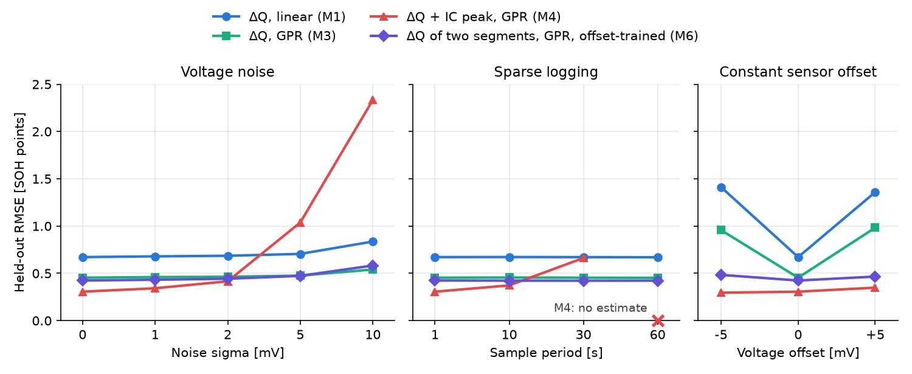
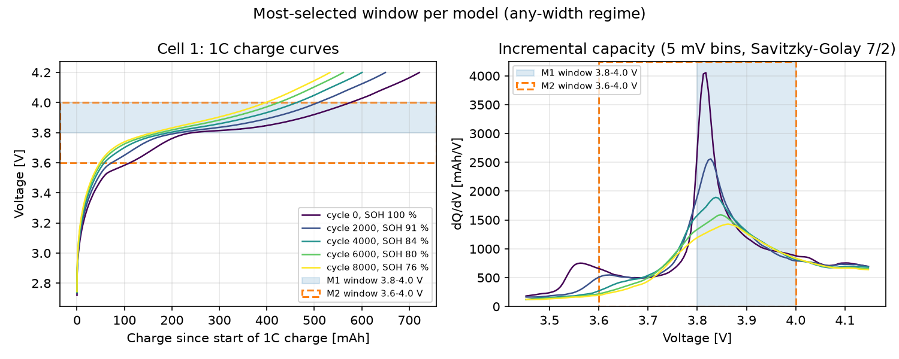

# Battery state of health from a partial charge

[](https://github.com/aqjole/charge-window-soh/actions/workflows/ci.yml)

A battery management system (BMS) rarely sees a full charge, and its voltage log is
noisy and sparse. This project estimates state of health (SOH: remaining capacity as
a percentage of the capacity when new) from a 25-35 minute slice of a
constant-current charge, using voltage and time only. It asks two questions:

1. How much does incremental-capacity (IC) analysis add over simply counting the
   charge between two voltage levels (ΔQ)?
2. Does that gain survive logs like a real BMS produces?

## Findings

- **On clean lab logs, IC helps.** Adding the IC peak takes a linear model from 0.67
  to 0.51 SOH points RMSE, and a Gaussian-process regression (GPR) from 0.45 to
  0.31, the best result here.
- **On BMS-like logs, IC is the first thing to break.** From 5 mV of voltage noise
  the IC models are worse than plain ΔQ (1.04 against 0.48 for the two GPR models),
  and at one sample per 60 s they give no estimate at all.
- **Plain ΔQ has one weak spot: a constant voltage-sensor offset.** ±5 mV doubles
  its error (0.45 to 0.96-0.98). Splitting the window into two segments and training
  on offset-shifted copies of the logs (model M6) brings that down to 0.47-0.48,
  with 0.42 on clean logs.
- **M6 is the only model below 0.6 in every tested condition, and it runs in C.**
  The streaming C99 estimator uses no heap and no sample buffer, and matches the
  Python reference to 1e-11 on all 519 charge curves.



*Held-out RMSE of four of the seven models under three log faults. Every model and
every case: [`results/degraded.png`](results/degraded.png).*

Data: Oxford Battery Degradation Dataset 1, 8 cells, 519 charge curves. Every
accuracy number is from nested leave-one-cell-out validation: the cell being scored
is never used for fitting, for choosing the window or for calibration.

## What was built

- **Data audit.** The loader checks the file hash and five gates (time unit,
  constant current, curve counts, sample period, first label of each cell) before
  anything is fit.
- **Streaming window detector.** It measures the time between two voltage levels
  with running sums and no buffer, and stays accurate on noisy logs. A trace
  that cannot be estimated returns a reason code and is counted, never dropped.
- **Seven models, M0-M6**, from a training-mean baseline to GPR on two window
  segments with offset-augmented training.
- **Nested leave-one-cell-out validation** with a decision rule fixed in advance:
  an addition counts as a gain only if it is better on at least 7 of 8 held-out
  cells.
- **BMS log simulation.** Decimation, sensor offset, Gaussian noise and ADC
  rounding, applied in logger order, with 20 random seeds per case.
- **C99 estimator.** Model headers are generated from the Python fit, and the C
  output is checked against Python on every trace.
- **Reproducibility.** One command regenerates every table and plot, with
  deterministic results. 94 tests run on synthetic traces, and CI builds the C code
  with gcc and clang under `-Werror`.

## Results

Error unit: **SOH points**, i.e. 100 · (estimated − measured capacity) / beginning-of-life
capacity. Each model picks its own voltage window inside every validation fold.

### Clean logs

| Model | Inputs | RMSE | Worst cell | Max error | Window (median) | 95 % interval covers |
|---|---|---:|---:|---:|---:|---:|
| M0 | none (training mean) | 6.77 | 7.92 | 24.4 | | |
| M1 | ΔQ, linear | 0.67 | 1.15 | 7.5 | 25 min | |
| M2 | ΔQ + IC peak, linear | 0.51 | 1.10 | 7.1 | 34 min | |
| M3 | ΔQ, GPR | 0.45 | 0.65 | 3.6 | 26 min | 91 % |
| M4 | ΔQ + IC peak, GPR | **0.31** | **0.44** | **2.1** | 34 min | 95 % |
| M5 | ΔQ of each window half, GPR | 0.41 | 0.84 | 5.0 | 32 min | 97 % |
| M6 | as M5, trained also on offset-shifted copies | 0.42 | 0.70 | 3.2 | 33 min | 93 % |

RMSE is pooled over all held-out traces. Worst cell is the highest single-cell RMSE.
Window is the median time the selected window takes at 1C. Coverage uses calibrated
GPR intervals.

Verdicts under the 7-of-8-cells rule:

- **IC peak, linear (M2 vs M1):** helps, better on 8 of 8 cells.
- **IC peak, GPR (M4 vs M3):** better on 6 of 8, so no detectable gain when each
  model picks its window freely. At an equal 200 or 300 mV width it passes (7 and 8 of 8).
- **Two segments (M5 vs M3):** better on 6 of 8, so no detectable gain.
- **Offset augmentation (M6 vs M5):** better on 3 of 8, so no detectable gain on
  clean logs. Under a ±5 mV offset it helps (7 and 8 of 8).

### BMS-like logs

Each fold's frozen model is applied to degraded copies of its held-out cell, with
20 random seeds where noise or sampling phase is random. Every model answers 100 % of
traces unless marked.

| Log condition | M1<br>ΔQ<br>linear | M2<br>ΔQ + IC<br>linear | M3<br>ΔQ<br>GPR | M4<br>ΔQ + IC<br>GPR | M5<br>2 segments<br>GPR | M6<br>M5, offset-trained |
|---|---:|---:|---:|---:|---:|---:|
| Clean | 0.67 | 0.51 | 0.45 | **0.31** | 0.41 | 0.42 |
| Noise σ = 2 mV | 0.69 | 0.53 | 0.46 | **0.42** | 0.43 | 0.44 |
| Noise σ = 10 mV | 0.84 | 1.56 | **0.54** | 2.33 | 0.67 | 0.58 |
| Offset ±5 mV | 1.36-1.41 | 0.54-0.56 | 0.96-0.98 | **0.30-0.35** | 0.93-1.03 | 0.47-0.48 |
| ADC step 5 mV | 0.92 | 0.53 | 0.64 | 0.78 | 0.57 | **0.44** |
| One sample per 30 s | 0.67 | 0.57 | 0.45 | 0.66 | **0.41** | 0.42 |
| One sample per 60 s | 0.67 | no answer | 0.45 | no answer | **0.42** | **0.42** |
| Combined: 2 mV noise, 1 mV ADC step, 10 s | 0.84 | 0.63 | **0.55** | 0.81 | 0.59 | 0.59 |

What the table shows:

- **The IC peak is the noise-sensitive part.** It comes from a numerical derivative,
  so noise and coarse sampling hit the IC models first. At 60 s logging the window
  has too few samples for an IC curve at all.
- **ΔQ is a time measurement and barely notices noise or sparse logging**, provided
  the window detector averages repeated level crossings (see Method). A detector
  that takes the first crossing gives 4.26 for M1 at 10 mV noise, against 0.84.
- **A constant voltage offset is the one thing plain ΔQ cannot absorb.** It moves the
  window levels themselves. The IC models are nearly immune; the measured peak
  voltage moves with the offset, which likely lets them correct for it.
- **Training on offset-shifted logs fixes most of it.** M6 halves M5's offset error
  and keeps its tolerance of noise and sparse logging. The same training does not
  help M1: with one ΔQ input, an offset looks like a capacity change.
- **Calibrated intervals hold on clean data but not off it.** Calibrated M3 and M5
  intervals cover only 53-66 % under a ±5 mV offset (M6 86-92 %); M4 covers 49 % at
  5 mV noise.
- **Averaging a few charges removes most of the random part.** A BMS sees a charge
  every cycle, so it can average its last estimates. With the mean of 5 simulated
  repeats, the combined case drops from 0.59 to 0.44 (M5) and 0.46 (M6), close to
  their clean 0.41 and 0.42. It does not repair the IC models under noise (M4 at
  10 mV: 2.33 to 2.25), where the error is a bias, and it cannot remove a constant
  offset ([details](results/README.md#averaging-over-charges)).

Per-cell tables, the window-width trade-off, interval calibration and every
degraded case are in [`results/`](results/README.md).

## Method



**Data.** [Oxford Battery Degradation Dataset 1](https://doi.org/10.5287/bodleian:KO2kdmYGg)
(Howey and Birkl, University of Oxford, 2017): 8 Kokam 740 mAh pouch cells cycled at
40 °C, with a 1C characterization every 100 cycles, giving 519 charge curves. The
estimator sees only voltage and time of the 1C constant-current charge (current is
taken as the nominal 740 mA). The label is the capacity of the paired 1C discharge.
SOH is that capacity over the cell's first capacity, which a BMS would store at
beginning of life. The audit report is in [`results/audit.md`](results/audit.md).

**Window and features.** A window [V1, V2] is a voltage band on the charge curve.
The grid has V1 from 3.5 to 3.9 V and widths of 100-400 mV, with V2 at most 4.15 V,
giving 17 windows.

- *Window detector:* time-below-level. Between arming (below V1 − 10 mV) and done
  (above V2 + 30 mV), it accumulates how long the voltage spends below V1 and below
  V2. On a clean trace this equals the interpolated crossing times. With noise,
  repeated crossings average out instead of the first one winning.
- *ΔQ* = 740 mA × (time between the two levels).
- *IC peak:* height and voltage of the dQ/dV maximum inside the window (5 mV bins,
  Savitzky-Golay 7 points, order 2). These settings were fixed before the first run
  that used them and not tuned afterwards.
- *Two segments:* ΔQ of each half of the window, split at the midpoint voltage.
- *No estimate:* a trace that never arms, never completes, has a gap over 120 s
  or gives no usable IC peak counts as unanswered, by reason.

**Models.** M0-M6 as in the clean-logs table. M6 also trains on two copies of each
training trace with a constant offset drawn from ±8 mV; copies are never scored. GPR
uses a Matérn 5/2 kernel with one length scale per input plus a white-noise term, on
standardized inputs, with fixed seeds.

**Validation.** Nested leave-one-cell-out:

- *Outer loop:* each cell is held out once.
- *Inner loop:* inside each fold, every model picks its window by a second
  leave-one-cell-out on the 7 training cells. The score is mean per-cell RMSE, a
  window must answer at least 95 % of traces, and ties go to the narrower window.
- *Comparisons:* paired on the traces both models answered, with the 7-of-8-cells
  rule (one-sided sign test, p = 0.035).
- *GPR intervals:* calibrated per fold from the inner held-out errors, so the
  calibration also uses training cells only.

**BMS-like logs.** Each fold's frozen model sees degraded copies of its held-out
cell. Degradation is applied in logger order: decimate (sample-and-hold, random
phase), add offset and Gaussian noise, round to the ADC step. Then detection and
features run as usual.

## C estimator

`c/soh_est.c` is a streaming estimator in C99, double precision. It keeps three
running sums and the previous sample, with no heap and no sample buffer:

```c
soh_est e;
soh_est_init(&e, &cfg);                /* window, C0, and the M1 or M6 model */
for (...) soh_est_feed(&e, t_s, v_mV); /* SOH_RUNNING until the window completes */
if (soh_est_finish(&e) == SOH_OK) use(e.soh);
else report(e.status);                 /* NOT_ARMED, NO_V2 or GAP */
```

It runs either of two shipped models:

| | M1 | M6 |
|---|---|---|
| Model | linear in ΔQ | GPR mean on the ΔQ of two segments |
| Window | 3.8-4.0 V | 3.6-4.0 V |
| Stored constants | 2 coefficients | 1,557 training points, about 37 kB as doubles |
| Work per estimate | one multiply-add | 1,557 kernel evaluations, once per charge |
| RMSE, clean logs | 0.67 | 0.42 |
| RMSE, ±5 mV offset | 1.36-1.41 | 0.47-0.48 |
| Largest SOH difference from Python | below 1e-14 | below 1e-11 |

The RMSE rows are the nested validation results above, not scores on the cells the
shipped models were fit to. Each shipped model is frozen by applying the window rule
once more over all 8 cells and then fitting on all of them. `python -m soh.freeze`
writes the result to [`c/soh_model.h`](c/soh_model.h) and `c/soh_model_m6.h`:

- **M1:** capacity = 91.93 + 1.987 · ΔQ [mAh]. The top three windows were nearly
  tied (0.575 vs 0.578, [`results/frozen.md`](results/frozen.md)).
- **M6:** the 519 measured traces and their 1,038 offset-shifted copies, with the
  GPR weights ([`results/frozen_m6.md`](results/frozen_m6.md)). The C code computes
  the predictive mean only; the interval needs a 1,557 × 1,557 matrix and is not
  exported.

`build/replay` streams exported traces through the C code. On all 519 clean traces
and on seed 0 of the combined degraded case, both models return the same reason
code as Python for every trace, and SOH (as a fraction) agrees within the bounds in
the table, against a gate of 1e-4 ([`results/c_agreement.md`](results/c_agreement.md)).
For M6 the reference is the fitted scikit-learn GPR. Unit tests also check the C
code against Python on synthetic traces that exercise every reason code.

## Limitations

- **One cell type, one temperature, one charge protocol.** 8 cells at 40 °C, a clean
  1C constant-current charge from empty. No claim beyond that.
- **Exploratory use of the 8 cells.** The detector change, M5, interval
  calibration, M6 and charge averaging were added after earlier results on the same
  8 cells. The nested validation keeps each number honest, but the choice of which
  models to report was not blind. A new dataset would be needed for a generalization
  claim.
- **Repeated charges are simulated.** The dataset has one charge per 100 cycles, so
  the averaged charges are independent noisy logs of the same charge. Real
  consecutive charges also differ in temperature and starting state.
- **Two cells have sudden capacity drops** (cells 2 and 5, see
  [`results/capacity_fade.png`](results/capacity_fade.png)). Cell 5 loses 20 SOH
  points at its last check (cycle 5000). Cell 2 dips by 5 points at cycle 5000 and by
  8 at cycle 7400, and recovers at the following checks, partly after the first dip
  and fully after the second. Every model's largest error falls on one of these two
  cells.
- **Sensor errors not covered.** Current is assumed constant and known; a current-gain
  error passes one-to-one into ΔQ and is not tested. Voltage offset is tested only as
  a constant; a drifting offset is not.
- **Beginning-of-life capacity must be stored** per cell to turn capacity into SOH.
- **Bench and offline only.** The C code is double precision and has not been
  ported to a microcontroller. For M6 it returns the estimate without its interval.

## Next steps

- **Charge averaging in C.** A running mean of the last 5 estimates takes M6 from
  0.59 to 0.46 in the combined case in the Python simulation. The C estimator does
  not have it yet.
- **A smaller M6.** The shipped model stores all 1,557 training points. A reduced
  training set and single precision would be needed for a small microcontroller,
  and are untested.
- **Below 0.31 on clean logs, nothing is demonstrated.** Giving each cell its own
  beginning-of-life charge curve as a reference was screened and did not help
  ([`results/`](results/README.md#beginning-of-life-reference)). The headroom is
  small: the capacity of the complete charge, as a single input, also gives 0.31
  ([`results/`](results/README.md#headroom-on-clean-logs)).
- **Any further model is judged by the same rule:** better on at least 7 of 8 held-out
  cells, with worst-cell RMSE and max error reported next to it.

## Related work

Richardson, Birkl, Osborne and Howey, *Battery capacity estimation from
partial-charging data using Gaussian process regression*, ASME Dynamic Systems and
Control Conference 2017 (DSCC2017-5365), use the same 519 curves. They regress
capacity with a GP on the times to reach four equally spaced voltages inside a
measured segment, with leave-one-cell-out validation. They report capacity RMSE in
percent: 2.10 % with 10 s of data and 1.10 % with 450 s (both starting at 3.5 V),
and 0.49 % with 1,450 s starting at 3.7 V.

These are not directly comparable with the numbers here. Their label is capacity
from integrating the charge curve. The quoted figures are single entries of a grid
of results over start voltage and duration, not windows chosen inside each fold.
And the logs are clean. For scale, M3 with a
window of about 26 min (1,570 s) reaches 0.45 SOH points.

## Reproduce

Requires [uv](https://docs.astral.sh/uv/), Python 3.11 and a C99 compiler.

```bash
make data        # downloads the dataset (about 254 MB) to data/raw/, checked by SHA-256
make reproduce   # tests, audit, validation, degraded logs, frozen models, C agreement
```

`make reproduce` takes about 80 minutes on a busy 8-core laptop, mostly M6's GPR
fits. Results are deterministic: afterwards `git diff results/*.csv` is empty.
`make test` alone needs no dataset; CI runs it on every push, together with a
`-Werror` build of the C code with gcc and clang.

| Path | Contents |
|---|---|
| `src/soh/` | `load` (audit), `features` (detector, IC), `models`, `validate` (nested), `degrade`, `freeze`, `export`, `agree` |
| `c/` | streaming estimator, generated model headers, replay tool |
| `tests/` | synthetic-trace tests for the detector, IC, validation rules, degradation and C code |
| `results/` | every table (CSV and Markdown) and plot; guide in [`results/README.md`](results/README.md) |

## Data source

Howey, D., & Birkl, C. (2017). *Oxford Battery Degradation Dataset 1*. University of
Oxford. [doi:10.5287/bodleian:KO2kdmYGg](https://doi.org/10.5287/bodleian:KO2kdmYGg).
The dataset is published under the Open Database License (ODC-ODbL). It is
downloaded by `make data` and is not part of this repository.
