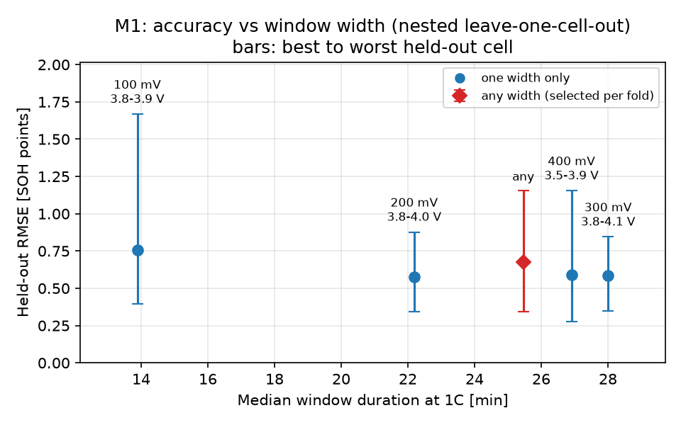
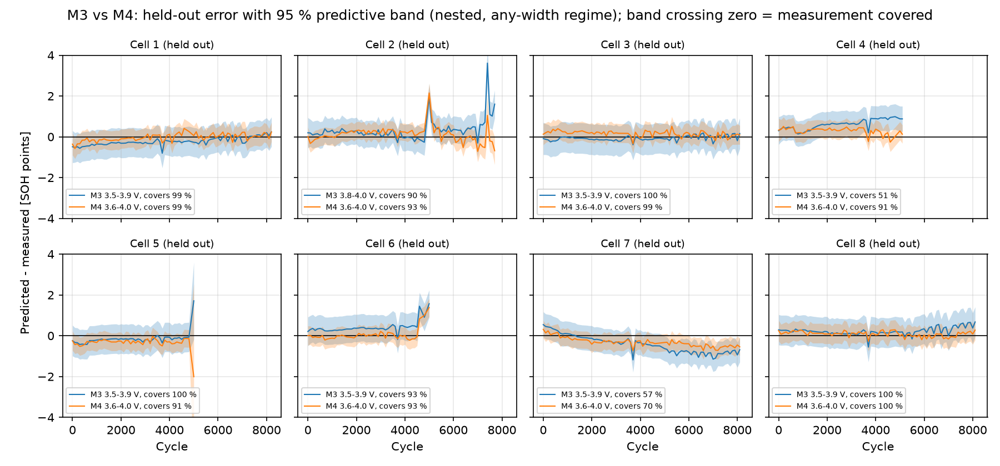

# Results

Everything in this folder is written by `make reproduce`. Each table comes as CSV (for
diffing and reuse) and Markdown (for reading), with a note at the top that defines
its columns. Errors are in **SOH points**, 100 · (estimated − measured capacity) /
the cell's first capacity, on answered traces only. The top-level
[README](../README.md) has the summary; this page has the details.

## Files

| File | What it holds |
|---|---|
| [`audit.md`](audit.md), [`capacity_fade.png`](capacity_fade.png) | Data checks (file hash, time unit, constant current, cutoff, curve counts) and capacity against cycle per cell |
| [`clean_nested.md`](clean_nested.md) | Main table: every model, any-width and fixed-width regimes, pooled and macro RMSE, max error, answer rate, window duration, raw and calibrated GPR coverage |
| [`clean_nested_per_cell.md`](clean_nested_per_cell.md) | The same, per held-out cell |
| [`paired.md`](paired.md), [`paired_per_cell.md`](paired_per_cell.md) | Each model against its control on commonly answered traces, with the 7-of-8-cells verdict |
| [`window_log.md`](window_log.md) | Window chosen in each outer fold, its inner score and the GPR calibration factor k95 |
| [`inner_scores.md`](inner_scores.md) | Every inner leave-one-cell-out score behind those choices |
| [`degraded.md`](degraded.md), [`degraded.png`](degraded.png) | Every model under every degraded-log case, both window detectors, seed spread |
| [`degraded_paired.md`](degraded_paired.md) | Paired verdicts per degraded case |
| [`degraded_avg.md`](degraded_avg.md) | Mean of 5 charges against a single charge, per degraded case with random noise or phase |
| [`accuracy_vs_window.png`](accuracy_vs_window.png) | M1 accuracy against window length |
| [`charge_curves_window.png`](charge_curves_window.png) | Charge and IC curves of cell 1 with the most-selected windows |
| [`predictions_gpr.png`](predictions_gpr.png) | M3 and M4 held-out error over life, with calibrated 95 % bands |
| [`frozen.md`](frozen.md), [`frozen_scores.md`](frozen_scores.md) | The shipped M1: window, coefficients, selection scores |
| [`c_agreement.md`](c_agreement.md) | C estimator against the Python reference |

## Clean logs

### Window width

Each model is also run with its window restricted to one width (RMSE, nested):

| Model | Any width | 100 mV | 200 mV | 300 mV | 400 mV |
|---|---:|---:|---:|---:|---:|
| M1 ΔQ, linear | 0.67 | 0.76 | **0.57** | 0.58 | 0.59 |
| M2 ΔQ + IC, linear | 0.51 | n/a | 0.68 | 0.60 | **0.51** |
| M3 ΔQ, GPR | 0.45 | 0.61 | 0.64 | 0.72 | **0.45** |
| M4 ΔQ + IC, GPR | **0.31** | n/a | 0.39 | 0.34 | **0.31** |
| M5 two segments, GPR | 0.41 | 0.62 | 0.52 | 0.95 | **0.34** |
| M6 M5 + offset-shifted training copies | 0.42 | 0.51 | 0.43 | 0.52 | **0.36** |

- **Free window choice is not always best.** For M1 the folds disagree on the window
  (3.8-4.0, 3.8-4.1 and 3.5-3.9 V), and the any-width result (0.67) is worse than
  fixing 200 mV (0.57). With 7 training cells, the inner scores of the top windows
  are within noise of each other.
- **Below 200 mV, accuracy drops**, and the spread between cells widens sharply
  (M1 at 100 mV: worst cell 1.7, max error 10.7).
- **The IC models have no 100 mV window** that answers 95 % of traces. The best,
  3.8-3.9 V, answers 88 %. For windows starting at 3.8 V, early-life traces lose
  their IC estimate partly because of a smoothing edge effect: the dQ/dV peak
  (about 3.82 V) lies within the Savitzky-Golay half-width of the window edge. The
  IC settings were frozen before the first run, so this is reported rather than tuned
  away.
- **M5 is unstable at 300 mV:** one cell misses by up to 18 points (M6: under 2).
- **Four segments were screened and not added.** In a fixed-window leave-one-cell-out
  check (not nested, not part of `make reproduce`), M6 with the window split into four
  segments had a lower RMSE than M6 at all four windows tried (0.30-0.42 against
  0.36-0.55) but a larger worst miss at three of them (at 3.6-4.0 V: 3.3 points against
  1.9), and beat M6 on 7 of 8 cells at only one window.

### Paired comparisons

| Comparison | Any width | 200 mV | 300 mV | 400 mV |
|---|---|---|---|---|
| IC peak, linear (M2 vs M1) | **helps** (8/8) | 5/8 | 6/8 | **helps** (8/8) |
| IC peak, GPR (M4 vs M3) | 6/8 | **helps** (7/8) | **helps** (8/8) | 6/8 |
| Two segments (M5 vs M3) | 6/8 | 5/8 | 6/8 | 6/8 |
| Offset augmentation (M6 vs M5) | 3/8 | **helps** (7/8) | 4/8 | 3/8 |

The cell counts give the number of held-out cells on which the model beats its
control. The rule, fixed before the first run, needs 7 of 8 (one-sided sign test,
p = 0.035); anything less is reported as "no detectable gain". In the any-width
column the two models may use different windows, so part of a gain can come from a
longer window; the fixed-width columns compare at equal width. M6 also helps at
100 mV (7/8).

### Per cell

| Cell | M1 | M2 | M3 | M4 | M5 | M6 |
|---:|---:|---:|---:|---:|---:|---:|
| 1 | 0.54 | 0.15 | 0.30 | 0.18 | 0.29 | 0.23 |
| 2 | 0.74 | 0.59 | 0.62 | 0.40 | 0.57 | 0.70 |
| 3 | 0.34 | 0.14 | 0.14 | 0.21 | 0.21 | 0.22 |
| 4 | 0.84 | 0.61 | 0.65 | 0.33 | 0.32 | 0.56 |
| 5 | 1.15 | 1.10 | 0.33 | 0.44 | 0.84 | 0.52 |
| 6 | 0.76 | 0.43 | 0.49 | 0.30 | 0.38 | 0.43 |
| 7 | 0.54 | 0.52 | 0.61 | 0.39 | 0.22 | 0.36 |
| 8 | 0.50 | 0.17 | 0.30 | 0.15 | 0.25 | 0.23 |

RMSE per held-out cell, any-width regime. Cells 2 and 5 have sudden
capacity drops ([`capacity_fade.png`](capacity_fade.png)): cell 5 loses 20 SOH points
at its last check (cycle 5000), and cell 2 dips by 5 points at cycle 5000 and by 8 at
cycle 7400, recovering partly after the first and fully after the second. Every
model's largest single error falls on one of these two cells.

### Beginning-of-life reference

Every model here is a population model: it never sees the held-out cell's own first
charge curve. A fixed-window leave-one-cell-out check (not nested, not part of
`make reproduce`) tested whether that curve helps. It scored each cell's later traces
only, with M3 at 3.5-3.9 V and M4 and M5 at 3.6-4.0 V. It was screened and not added:

- **There is a per-cell error, but the first trace does not reveal it.** A constant
  per cell accounts for 33-50 % of the squared held-out error. Across cells, the error
  on the first trace correlates with it only weakly (+0.3 for M3 and M4, about 0 for M5).
- **Correcting each cell by its first-trace error raised the pooled RMSE** (M3 0.45 to
  0.50-0.52, M4 0.31 to 0.35-0.37, M5 0.33 to 0.53-0.59) and beat the uncorrected
  model on at most 6 of 8 cells.
- **GPRs on ΔQ relative to the first trace did worse than the population models.**
  Predicting capacity retention from ratios, or from present values plus their
  changes, gave 0.49-0.58 against 0.45 (M3) and 0.33 (M5) at the same windows. One
  variant, two segments plus their changes at 3.6-4.0 V, reached 2.03.

### Headroom on clean logs

A fixed-window leave-one-cell-out check (not nested, not part of `make reproduce`)
looked at how much error is left to remove:

- **The labels repeat to about 0.13 points.** This is the check-to-check scatter of
  the measured capacity around its trend, so no estimator can score below it.
- **The complete charge gives 0.31.** A linear model on the capacity of the whole
  charge, from empty to the cutoff, reaches 0.31. M4 gets the same from a 34-minute
  window.
- **With everything, 0.24.** A GPR on the complete-charge capacity plus the two
  segments at 3.6-4.0 V reached 0.24. It needs a full charge from empty, which is
  outside the question here.
- **Averaging the M4 and M5 estimates** gave 0.27 against M4's 0.31 at 3.6-4.0 V,
  better on 7 of 8 cells. It was not added: the gain is small and half of the
  estimate inherits M4's noise sensitivity.

### GPR intervals

The raw GPR 95 % intervals cover 87 % (M3), 92 % (M4), 92 % (M5) and 92 % (M6) of held-out
measurements. They reflect noise within the training cells, not the spread between
cells. Each fold therefore calibrates its intervals on its own training cells: the
predictive std is scaled by k95, the 95th percentile of |error| / std over the inner
held-out predictions, divided by 1.96. This reuses the inner fits; k95 ranges from
1.01 to 1.57.

| Model | Raw coverage | Calibrated coverage | Calibrated width |
|---|---:|---:|---:|
| M3 | 87 % | 91 % | 1.9 points |
| M4 | 92 % | 95 % | 1.1 points |
| M5 | 92 % | 97 % | 1.4 points |
| M6 | 92 % | 93 % | 1.4 points |

Calibration fixes the average, not cells whose error drifts with age. Cell 7 stays
at 68 % (M3) and 77 % (M4), and cell 4 at 72 % (M3).

## BMS-like logs

Each outer fold's model, at the window it selected and fit on clean training cells,
is frozen and applied to degraded copies of its held-out cell. Per trace, in logger
order:

1. decimate to the logging period (sample-and-hold, random phase);
2. add a constant offset and Gaussian noise;
3. round to the ADC step.

Detection and features then run on the degraded trace. Cases: noise 1, 2, 5 and
10 mV; offset ±5 mV; ADC step 1 and 5 mV; logging every 1, 10, 30 and 60 s; and a
combined case (2 mV noise, 1 mV step, 10 s). There are 20 seeds where anything is
random, one run otherwise. The clean case is checked at run time against the nested
table.

### Window detector

Every case is also run with the first-crossing rule that the project used before
(fold models refit on its clean features at the same windows). With noise, the
first sample to cross a level fires early, by roughly σ / (dV/dt), worst where the
charge curve is flat. Time-below-level instead averages the repeated crossings.

| Case | M1, first crossing | M1, time below level | M3, first crossing | M3, time below level |
|---|---:|---:|---:|---:|
| Noise 2 mV | 1.15 | 0.69 | 0.75 | 0.46 |
| Noise 5 mV | 2.43 | 0.71 | 1.74 | 0.48 |
| Noise 10 mV | 4.26 | 0.84 | 3.76 | 0.54 |
| Combined | 1.02 | 0.84 | 0.64 | 0.55 |

On clean traces the two rules are identical.

### What breaks which model

- **Noise:** the IC models break first. At 5 mV, M4 is at 1.04 against M3's 0.48,
  and M2 at 0.79 against M1's 0.71. At 10 mV: M4 2.33, M2 1.56.
- **Logging period:** ΔQ does not care (M1 and M3 are flat up to 60 s). The IC peak
  needs samples inside the window. M4 rises to 0.66 at 30 s, and at 60 s every trace
  is too sparse for an IC curve, so M2 and M4 give no estimate.
- **ADC step:** a 5 mV step costs M1 (0.92) and M4 (0.78) the most.
- **Offset:** shifts the window levels, which no detector can undo. M1 goes from 0.67
  to 1.36-1.41 at ±5 mV, M3 to 0.96-0.98, M5 to 0.93-1.03. The IC models barely move
  (M4 0.30-0.35). M6 goes from 0.42 to 0.47-0.48 and helps over M5 (7 and 8 of 8);
  its calibrated intervals still cover 86-92 %, against 53-62 % for M5.
- **M5** keeps part of what curve shape adds where the IC peak fails (0.47 at 5 mV
  noise, 0.42 at 60 s), but it is as offset-sensitive as the other ΔQ models and is
  never better than M3 on 7 of 8 cells.

Paired verdicts across cases ([`degraded_paired.md`](degraded_paired.md)):

- **M2 vs M1:** IC still helps the linear model under 1-2 mV noise, offset, both ADC
  steps, logging up to 30 s and the combined case. It fails at 5 and 10 mV noise.
- **M4 vs M3:** IC helps the GPR only under offset.
- **M5 vs M3:** never a detectable gain.

### Averaging over charges

A BMS sees a charge every cycle, and SOH moves by under 0.005 points per cycle, so
it can average its last few estimates. The dataset has one charge per 100 cycles, so
the repeats are simulated: the 20 seeds of a case are independent logs of the same
charge, split into blocks of 5, and each block's estimates are averaged
([`degraded_avg.md`](degraded_avg.md)). RMSE, single charge → mean of 5:

| Case | M1 | M2 | M3 | M4 | M5 | M6 |
|---|---:|---:|---:|---:|---:|---:|
| Noise 2 mV | 0.69 → 0.67 | 0.53 → 0.51 | 0.46 → 0.45 | 0.42 → 0.35 | 0.43 → 0.41 | 0.44 → 0.43 |
| Noise 5 mV | 0.71 → 0.66 | 0.79 → 0.76 | 0.48 → 0.45 | 1.04 → 0.96 | 0.47 → 0.42 | 0.47 → 0.43 |
| Noise 10 mV | 0.84 → 0.75 | 1.56 → 1.52 | 0.54 → 0.48 | 2.33 → 2.25 | 0.67 → 0.58 | 0.58 → 0.48 |
| One sample per 30 s | 0.67 → 0.67 | 0.57 → 0.52 | 0.45 → 0.45 | 0.66 → 0.44 | 0.41 → 0.41 | 0.42 → 0.42 |
| Combined | 0.84 → 0.71 | 0.63 → 0.54 | 0.55 → 0.48 | 0.81 → 0.54 | 0.59 → 0.44 | 0.59 → 0.46 |

- **It brings the ΔQ models back near their clean level** where the damage is
  random: in the combined case M5 ends at 0.44 (clean 0.41) and M6 at 0.46 (clean
  0.42). Their largest miss also shrinks (M5 7.3 to 5.0, M6 4.3 to 3.2).
- **It does not repair the IC models under noise.** M4 at 10 mV stays at 2.25:
  noise flattens the IC peak the same way in every charge, so the error is a bias.
  Where the IC error is random, from the sampling phase, averaging removes it (M4
  at 30 s: 0.66 to 0.44).
- **It does nothing for an error that repeats**, such as a constant offset. Those
  cases have a single run and are not in the table.
- **The 7-of-8-cells rule is not applied.** On the same charges a mean cannot have
  a higher RMSE than its members, so the rule would pass by construction.

### Interval coverage off clean data

Calibrated coverage, from clean data to degraded:

| Model | Clean | Noise 5 mV | Noise 10 mV | Offset ±5 mV | Combined |
|---|---:|---:|---:|---:|---:|
| M3 | 91 % | 91 % | 88 % | 64-66 % | 88 % |
| M4 | 95 % | 49 % | 31 % | 93-98 % | 56 % |
| M5 | 97 % | 90 % | 75 % | 53-62 % | 78 % |

The calibration is set on clean data, so it cannot anticipate a sensor error. Each
model's intervals fail on exactly the error that moves its point estimate.

## Shipped estimator

[`frozen.md`](frozen.md): the window rule is applied once more, over all 8 cells.
It picks 3.8-4.0 V, then M1 is fit on all cells:
capacity [mAh] = 91.925 + 1.98688 · ΔQ [mAh].

The selection score (0.575) is computed on the cells that chose the window, so it is
not an accuracy estimate; the nested M1 numbers are. The choice is close:

| Window | Selection score |
|---|---:|
| 3.8-4.0 V | 0.575 |
| 3.5-3.9 V | 0.578 |
| 3.8-4.1 V | 0.578 |

These are the same three windows the outer folds picked. All 17 scores are in
[`frozen_scores.md`](frozen_scores.md).

[`c_agreement.md`](c_agreement.md): the C estimator and Python read the same
exported traces. On all 519 clean traces and on seed 0 of the combined case, every
trace gets the same reason code. The SOH difference is below 1e-14, against a gate
of 1e-4. The real traces are all answered, so the other reason codes (never armed,
never completed, sample gap) are covered by synthetic-trace tests in
`tests/test_c_estimator.py`.
